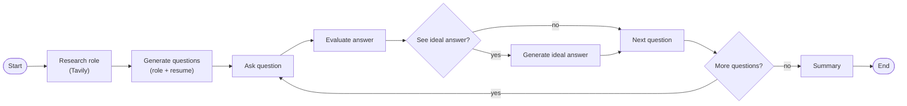

<div align="center">

# 🎯 Interview Preparation Chatbot

**Practice interviews that adapt to your target role and your actual resume.**
Get role-aware questions, honest scoring, and model answers, all from your terminal.


</div>

---

## ✨ What it does

| | |
|---|---|
| 🔍 **Role research** | Pulls current responsibilities, skills, and trends for your target role from the web (Tavily), cached per role. |
| 📄 **Resume-aware questions** | Parses your PDF resume and asks about *your* projects, not generic trivia. |
| 🧠 **Structured evaluation** | Every answer gets a 1-10 score, strengths, improvements, and a one-line justification. |
| ✨ **Ideal answers on demand** | Generates a concise model answer grounded in your real experience. It never invents projects or metrics. |
| 💡 **Stuck on a question?** | Type `explain` to get a simpler breakdown of what's being asked. |
| 📊 **Session summary** | Per-question scores, your average, and your weakest answer. Optionally saved as JSON. |

## 🧩 How it works

The app is a [LangGraph](https://langchain-ai.github.io/langgraph/) state machine. Each node returns a partial state update, and conditional edges drive the interview loop.



| Node | Responsibility |
|---|---|
| `research` | Runs 4 role-focused searches in parallel and caches the result in `.cache/`. |
| `generate_questions` | Produces 5 questions (technical, project deep-dive, behavioral) via Pydantic structured output. |
| `ask_question` | Collects your multi-line answer; handles `done`, `skip`, `explain`. |
| `evaluate` | Scores the answer with a separate, deterministic (temperature 0) evaluator model. |
| `ask_ideal` / `generate_ideal` | Optionally writes a model answer using the question, your answer, the feedback, and your resume. |
| `summary` | Prints scores, the average, and your weakest question. |

## 🚀 Quick start

**Prerequisites:** Python 3.12+, [uv](https://docs.astral.sh/uv/), a [Groq API key](https://console.groq.com/keys), and a [Tavily API key](https://app.tavily.com/).

```bash
# 1. Clone and install
git clone https://github.com/<your-username>/interview-preparation-chatbot.git
cd interview-preparation-chatbot
uv sync

# 2. Add your keys
cp .env.example .env   # then edit .env

# 3. Run
uv run python interview_graph.py --role "AI Agent Intern" --resume resume.pdf
```

No `pyproject.toml` yet? Create the environment with:

```bash
uv add langgraph langchain-groq langchain-core tavily-python python-dotenv pydantic pypdf
```

### Environment variables

```env
GROQ_API_KEY=gsk_...
TAVILY_API_KEY=tvly-...

# Optional: override the default models
GENERATOR_MODEL=openai/gpt-oss-120b
EVALUATOR_MODEL=openai/gpt-oss-20b
```

## 🕹️ Usage

```bash
uv run python interview_graph.py --role "Data Science Intern" --resume resume.pdf --save session.json
```

| Flag | Description | Default |
|---|---|---|
| `--role` | Target job role | `Deep Learning Intern` |
| `--resume` | Path to your resume PDF (optional) | none |
| `--save` | Write the full session (questions, answers, feedback) to a JSON file | none |

**While answering:**

| Input | Effect |
|---|---|
| `done` (on its own line) | Submit your answer |
| `explain` (as the first line) | Get a simpler explanation of the question, then answer |
| `skip` (as the first line) | Skip the question |

<details>
<summary><b>Example session</b> (illustrative)</summary>

```text
--- 🔍 GATHERING JOB ROLE CONTEXT ---
--- ✅ Context gathered for 'AI Agent Intern' ---

--- 🤖 GENERATING INTERVIEW QUESTIONS ---
--- ✅ 5 questions ready ---

Q1/5 [project]: In your WatchParty project, how did you keep playback in sync across clients?
Type your answer, then 'done' on its own line to submit.
I used Socket.IO rooms with the host as the source of truth and broadcast
play/pause/seek events with timestamps...
done

--- 📝 FEEDBACK ---
Score: 7/10 - Solid architecture, but latency and reconnect handling were not covered.

Strengths:
  + Clear source-of-truth design
Improve:
  - Mention drift correction and what happens on reconnect

See an ideal answer? [y/N]: n
```

</details>

## 📁 Project structure

```text
.
├── interview_graph.py            # LangGraph app + CLI
├── extract_data_from_resume.py   # PDF resume -> structured sections
├── pyproject.toml
├── .env                          # your keys (never commit)
├── .cache/                       # cached role research
└── session.json                  # optional saved session
```

## ⚙️ Configuration

Tweak these constants at the top of `interview_graph.py`:

| Constant | Purpose | Default |
|---|---|---|
| `NUM_QUESTIONS` | Questions per interview | `5` |
| `MAX_CONTEXT_CHARS` | Cap on research context sent to the LLM | `6000` |
| `MAX_RESUME_CHARS` | Cap on resume text sent to the LLM | `4000` |

### Resume parsing

`extract_data_from_resume.py` recognizes **summary, skills, projects, experience, education, certifications, and achievements** by exact header match (e.g. `TECHNICAL SKILLS`, `Projects:`). If your resume uses a different header, add it to `SECTION_ALIASES`.

You can inspect what the parser sees before running the interview:

```bash
uv run python extract_data_from_resume.py resume.pdf --json
```

> **Scanned PDFs** have no extractable text and need OCR first.

## 🛠️ Troubleshooting

<details>
<summary><b>Groq <code>401 Invalid API Key</code></b></summary>

An old `GROQ_API_KEY` set in your OS environment can take priority over `.env`. Check `echo $env:GROQ_API_KEY` in PowerShell, remove the stale value, or use `load_dotenv(override=True)`. Make sure `.env` has no quotes or trailing spaces.
</details>

<details>
<summary><b>Tavily "exceeds your plan's usage limit"</b></summary>

Research is optional. The app falls back to role + resume only. Cached roles never hit Tavily again, and the app uses `basic` search depth (1 credit per query) to stay cheap.
</details>

<details>
<summary><b>Decommissioned or unknown model</b></summary>

Groq retires models over time. Set `GENERATOR_MODEL` / `EVALUATOR_MODEL` in `.env` to any currently available model that supports tool calling.
</details>

<details>
<summary><b>The prompt seems frozen</b></summary>

It's waiting for input. Type `done` on its own line to submit your answer.
</details>

## 🔒 Privacy

Your resume text, answers, and role are sent to Groq (LLM) and, for the role name only, Tavily (search). Don't include sensitive personal data you wouldn't want processed by third-party APIs. Keep `.env`, `resume.pdf`, `session.json`, and `.cache/` out of version control:

```gitignore
.env
.venv/
.cache/
session.json
*.pdf
```

## 🗺️ Roadmap

- [ ] Web UI (FastAPI + React) with a timed-answer mode
- [ ] Voice answers (speech-to-text) for realistic practice
- [ ] Persistent progress tracking across sessions
- [ ] Rubric-based scoring per question category
- [ ] LangGraph checkpointing so interrupted sessions can resume

## 🤝 Contributing

Issues and PRs are welcome. For larger changes, open an issue first to discuss what you'd like to change.

## 📄 License

MIT. See [`LICENSE`](LICENSE).

---

<div align="center">
Built by <b>Suraj</b> with LangGraph, Groq, and Tavily.
</div>
